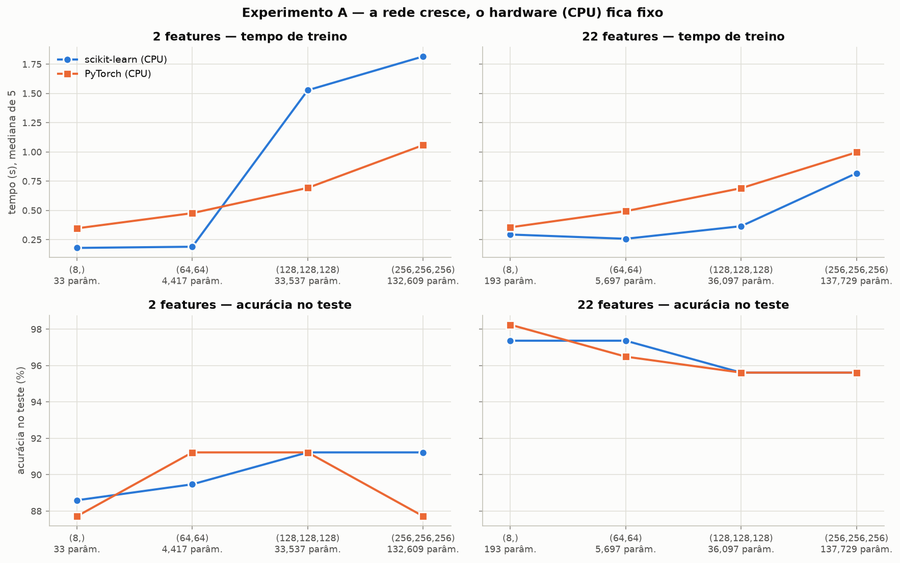
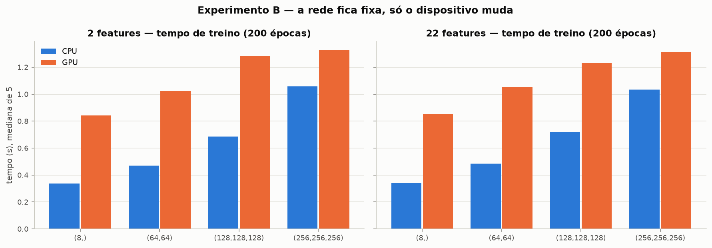
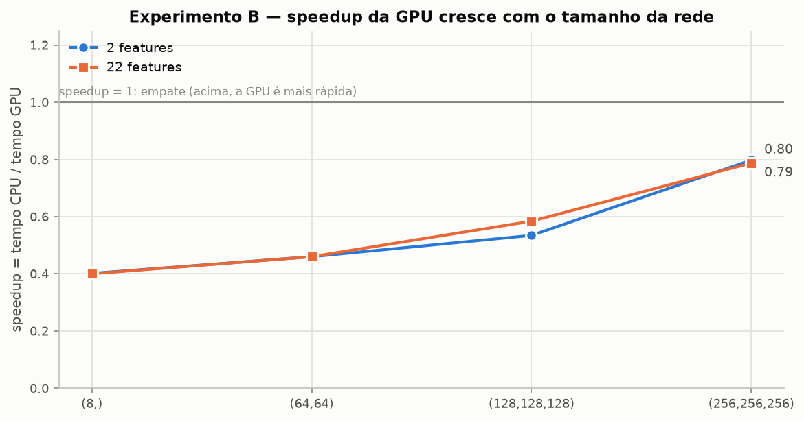
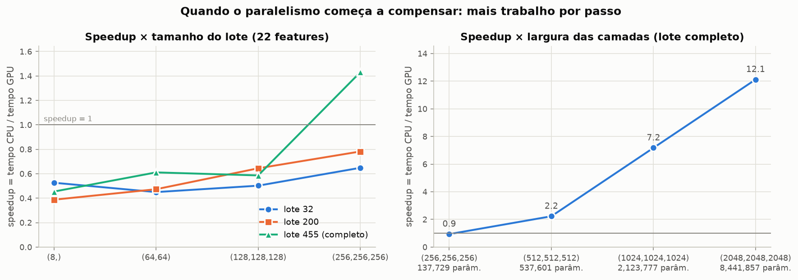

# CP2 · Escala Computacional em Redes Neurais

**IA e Machine Learning — Engenharia de Software** · ANN em scikit-learn e PyTorch · CPU × GPU · custo × desempenho

[](https://colab.research.google.com/github/lucksza/CP5-ML/blob/main/CP2_Escala_Computacional_Redes_Neurais.ipynb)

## Integrantes

| # | Integrante | RM |
|---|---|---|
| 1 | Lucca Borges | 554608 |
| 2 | Ruan Melo | 557599 |
| 3 | Rodrigo Jimenez | 558148 |
| 4 | João Victor Franco | 556790 |
| 5 | Bruno Leão | 555563 |

## Resultado em resumo

- Crescer a rede de 33 para 132.609 parâmetros
  **não trouxe ganho consistente de acurácia**: o maior ganho pontual da (256,256,256) sobre a (8,) (+2,63 p.p.)
  desaparece na média de 10 sorteios, e a melhor relação custo × benefício ficou com redes pequenas.
- O que melhorou o resultado de forma consistente foi passar de **2 para 22 features** (+4,39 a +10,53 p.p.).
- Neste problema pequeno, a **GPU foi mais lenta que a CPU nas 8 configurações** (speedup de 0,40 a
  0,80); ela só passou a compensar quando cada passo de treino teve muito mais cálculo
  (até 12,1× com camadas de 2048 neurônios).

## O que tem neste repositório

| Arquivo | Conteúdo |
|---|---|
| [`CP2_Escala_Computacional_Redes_Neurais.ipynb`](CP2_Escala_Computacional_Redes_Neurais.ipynb) | Notebook **executado, com todas as saídas**: Etapas A, B e C, Tabelas A e B, gráficos, evidências, análise complementar, checagem das respostas e respostas |
| [`entrega/CP2_Escala_Computacional_Redes_Neurais_preenchido.docx`](entrega/CP2_Escala_Computacional_Redes_Neurais_preenchido.docx) · [`.pdf`](entrega/CP2_Escala_Computacional_Redes_Neurais_preenchido.pdf) | Enunciado preenchido: integrantes, Tabelas A e B, respostas 1–8 e anexo com a saída da execução |
| [`resultados/`](resultados/) | CSVs com os valores brutos (inclui tempos mín./máx. de cada medição), `ambiente.json` e `selecao_features.json` |
| [`resultados/figuras/`](resultados/figuras/) | Gráficos gerados pelo notebook |
| [`requirements.txt`](requirements.txt) | Dependências |

## Como executar

- **Google Colab:** botão *Open in Colab* acima → *Ambiente de execução* → *Alterar tipo de ambiente de execução* →
  *Acelerador de hardware* → **GPU** → *Executar tudo*. O dataset vem do próprio scikit-learn (não há upload). Sem GPU, o
  notebook registra a indisponibilidade e segue com o que dá para medir.
- **Local:** `pip install -r requirements.txt` (para GPU NVIDIA, instale o `torch` com CUDA pelo índice oficial) e
  `jupyter nbconvert --to notebook --execute --inplace CP2_Escala_Computacional_Redes_Neurais.ipynb`.
- A execução registrada levou cerca de 5 minutos; em outro hardware o tempo muda. Uma nova execução recalcula as seções 1–10;
  as respostas (seção 11) foram redigidas sobre a execução registrada, e a **célula de checagem** da seção 11 mostra se a
  interpretação continua válida e se os números citados ainda são os da execução corrente (✔/✘).

## Ambiente da execução registrada

| Item | Valor |
|---|---|
| CPU | 11th Gen Intel(R) Core(TM) i7-11700K @ 3.60GHz — 8 núcleos físicos / 16 lógicos (PyTorch usando 8 threads) |
| GPU | NVIDIA GeForce RTX 3060 · 12,0 GB (CUDA 13.0) |
| RAM | 31,9 GB |
| Sistema | Windows 11 (build 26200) · Python 3.11.9 |
| Bibliotecas | numpy 2.4.6 · pandas 3.0.6 · scikit-learn 1.9.1 · torch 2.14.1+cu130 |
| Data | 2026-10-14 08:16 |

## Protocolo

- **Dados:** Breast Cancer Wisconsin (Diagnostic), 569 exames, `diagnosis` 1 = maligno / 0 = benigno.
- **`dados_reduzidos` (22 features):** o enunciado usa um `dados_reduzidos` com 22 features; aqui ele é construído por um
  filtro de redundância — de cada par com |correlação| > 0,92 sai a segunda coluna —, calculado só nas
  455 linhas de treino do sorteio principal. O limiar foi escolhido por levar exatamente às 22 features; a
  equivalência com a lista do notebook da disciplina não foi verificada (se for outra, basta trocar a célula da seção 2).
  Removidas: `perimeter_mean`, `area_mean`, `concave points_mean`, `perimeter_se`, `area_se`, `radius_worst`, `perimeter_worst`, `area_worst`. Mantidas: `radius_mean`, `texture_mean`, `smoothness_mean`, `compactness_mean`, `concavity_mean`, `symmetry_mean`, `fractal_dimension_mean`, `radius_se`, `texture_se`, `smoothness_se`, `compactness_se`, `concavity_se`, `concave points_se`, `symmetry_se`, `fractal_dimension_se`, `texture_worst`, `smoothness_worst`, `compactness_worst`, `concavity_worst`, `concave points_worst`, `symmetry_worst`, `fractal_dimension_worst`.
- **Etapas:** A com `radius_mean` e `texture_mean`; B com `X = dados_reduzidos.drop(columns=['diagnosis'])`; C com a mesma ANN
  do PyTorch em CPU e GPU.
- **Separação:** 80% treino / 20% teste (114 exames), estratificada, `random_state=42`; `StandardScaler` ajustado só no treino.
- **Redes:** (8,), (64,64), (128,128,128), (256,256,256) com ReLU e 1 saída; Adam (lr = 0,001) e lotes de 200 nos dois
  frameworks. O scikit-learn treina até atingir o critério de parada (teto de 1000 épocas); o PyTorch treina 200 épocas fixas
  com `BCEWithLogitsLoss`. Como os orçamentos de épocas diferem, as comparações são entre arquiteturas dentro de cada framework.
- **Tempo:** só o treino, mediana de 5 execuções após 1 aquecimento; na GPU, com `torch.cuda.synchronize()` e incluindo a cópia
  de modelo e dados para a placa. **Experimento B:** mesma rede, mesmos dados, épocas, perda, otimizador, pesos iniciais e ordem
  dos lotes — só o dispositivo muda.

## Tabela A — escala da ANN em CPU

| Entrada | Framework | Arquitetura | Parâmetros | Tempo (s) | Iter./épocas | Acurácia |
|---|---|---|---|---|---|---|
| 2 features | scikit-learn (CPU) | (8,) | 33 | 0,179 | 309 | 88,60% |
| 2 features | scikit-learn (CPU) | (64,64) | 4.417 | 0,190 | 128 | 89,47% |
| 2 features | scikit-learn (CPU) | (128,128,128) | 33.537 | 1,527 | 308 | 91,23% |
| 2 features | scikit-learn (CPU) | (256,256,256) | 132.609 | 1,816 | 135 | 91,23% |
| 2 features | PyTorch (CPU) | (8,) | 33 | 0,347 | 200 | 87,72% |
| 2 features | PyTorch (CPU) | (64,64) | 4.417 | 0,477 | 200 | 91,23% |
| 2 features | PyTorch (CPU) | (128,128,128) | 33.537 | 0,693 | 200 | 91,23% |
| 2 features | PyTorch (CPU) | (256,256,256) | 132.609 | 1,058 | 200 | 87,72% |
| 22 features | scikit-learn (CPU) | (8,) | 193 | 0,294 | 491 | 97,37% |
| 22 features | scikit-learn (CPU) | (64,64) | 5.697 | 0,257 | 158 | 97,37% |
| 22 features | scikit-learn (CPU) | (128,128,128) | 36.097 | 0,365 | 70 | 95,61% |
| 22 features | scikit-learn (CPU) | (256,256,256) | 137.729 | 0,818 | 57 | 95,61% |
| 22 features | PyTorch (CPU) | (8,) | 193 | 0,356 | 200 | 98,25% |
| 22 features | PyTorch (CPU) | (64,64) | 5.697 | 0,494 | 200 | 96,49% |
| 22 features | PyTorch (CPU) | (128,128,128) | 36.097 | 0,690 | 200 | 95,61% |
| 22 features | PyTorch (CPU) | (256,256,256) | 137.729 | 0,997 | 200 | 95,61% |

`Iter./épocas`: no scikit-learn é o `n_iter_` (épocas até o critério de parada); no PyTorch, as 200 épocas fixas.

## Tabela B — PyTorch em CPU × GPU

| Entrada | Arquitetura | Parâmetros | CPU (s) | GPU (s) | Speedup | Acurácia GPU |
|---|---|---|---|---|---|---|
| 2 features | (8,) | 33 | 0,338 | 0,842 | 0,40 | 87,72% |
| 2 features | (64,64) | 4.417 | 0,470 | 1,023 | 0,46 | 91,23% |
| 2 features | (128,128,128) | 33.537 | 0,686 | 1,284 | 0,53 | 91,23% |
| 2 features | (256,256,256) | 132.609 | 1,057 | 1,325 | 0,80 | 87,72% |
| 22 features | (8,) | 193 | 0,342 | 0,855 | 0,40 | 98,25% |
| 22 features | (64,64) | 5.697 | 0,486 | 1,056 | 0,46 | 96,49% |
| 22 features | (128,128,128) | 36.097 | 0,717 | 1,228 | 0,58 | 95,61% |
| 22 features | (256,256,256) | 137.729 | 1,034 | 1,313 | 0,79 | 95,61% |

speedup = tempo_CPU / tempo_GPU. Acurácia na CPU idêntica à da GPU nas 8 configurações (mesma rede, mesmos pesos iniciais).
A coluna CPU (s) é uma medição nova, intercalada com a GPU; por isso pode diferir da coluna PyTorch (CPU) da Tabela A (nesta
execução, até 4,0%) — a variação natural entre execuções repetidas do mesmo treino.
Em todas as 8 configurações, até a execução mais lenta da CPU foi mais rápida que a execução mais rápida da GPU (5 repetições
de cada lado; tempos mín./máx. em `resultados/tabela_B_cpu_gpu.csv`).

## Gráficos









## Respostas às questões de análise

> Respostas redigidas sobre a execução registrada em 2026-10-14 08:16 (assinatura das dependências: f75e366e0320acdf). Todos os números vêm dessa execução — Tabelas A e B e seções 9 e 10. O teste tem 114 exames: 1 acerto equivale a 0,88 p.p.

### 1. No seu run com 2 features, qual arquitetura apresentou a melhor relação entre tempo e acurácia?

**Resposta: a (64,64), nos dois frameworks — como melhor compromisso entre tempo e acurácia.**

Critério: primeiro a fronteira de Pareto (arquiteturas para as quais nenhuma outra é ao mesmo tempo mais rápida e pelo menos tão precisa) — scikit-learn: (8,), (64,64) e (128,128,128); PyTorch: (8,) e (64,64). Dentro dela, a (64,64) é o melhor compromisso:

- **PyTorch:** a (64,64) atinge 91,23% em 0,477 s — a maior acurácia do PyTorch com 2 features. A (128,128,128) empata nessa acurácia gastando 0,693 s (+45% de tempo, 7,6× os parâmetros), e a (256,256,256) leva 1,058 s para cair a 87,72%. Em relação à (8,) (0,347 s; 87,72%), a (64,64) ganha +3,51 p.p. (4 acertos a mais) com +37% de tempo.
- **scikit-learn:** a (64,64) fica em 89,47% com 0,190 s, quase o tempo da (8,) (0,179 s; 88,60%). Para ganhar mais 1,75 p.p. (2 acertos), é preciso ir à (128,128,128) (1,527 s) ou à (256,256,256) (1,816 s): 8,1× e 9,6× o tempo da (64,64). Escolher a (64,64) aqui é um compromisso: abre mão desses 2 acertos em troca de um treino 8,1 vezes mais rápido.
- **Robustez (seção 10.1):** em 10 sorteios de treino/teste, a (64,64) tem a maior média do scikit-learn (91,32% ± 2,09 p.p.) e empata com a maior média do PyTorch (91,05% ± 1,79 p.p.); a vantagem pontual da (128,128,128) no scikit-learn não se repete na média (90,26% ± 1,82 p.p.).

### 2. Qual arquitetura teve o maior aumento de parâmetros sem produzir ganho proporcional de acurácia?

**Resposta: a (256,256,256).** Com 2 features ela tem 132.609 parâmetros — 4.018× os da (8,) (+132.576) e 3,95× os da (128,128,128) (+99.072). Em troca:

- **scikit-learn:** a mesma acurácia da (128,128,128) (91,23% → 91,23%, 0,00 p.p.) e só +2,63 p.p. sobre a (8,), com 10,1× o tempo da (8,) (1,816 s × 0,179 s).
- **PyTorch:** a acurácia **cai** de 91,23% na (128,128,128) para 87,72% (−3,51 p.p.) — o mesmo nível da (8,) —, com 3,05× o tempo da (8,).
- **Com 22 features** o padrão se repete: 714× os parâmetros da (8,) e −1,75 p.p. (scikit-learn) / −2,63 p.p. (PyTorch) de acurácia.

### 3. Ao passar de 2 para 22 features, o que mudou em tempo e acurácia?

- **Acurácia — subiu nas 8 combinações**, de +4,39 p.p. a +10,53 p.p. (exemplos: (8,) no PyTorch 87,72% → 98,25% (+10,53 p.p.); (8,) no scikit-learn 88,60% → 97,37% (+8,77 p.p.); (256,256,256) no scikit-learn 91,23% → 95,61% (+4,39 p.p.) e no PyTorch 87,72% → 95,61% (+7,89 p.p.)). As 20 medidas extras (concavidade, pontos côncavos, textura e suavidade no pior caso etc.) carregam muito mais informação sobre o tumor do que só o raio e a textura médios.
- **Tempo no PyTorch (200 épocas fixas) — praticamente não mudou** (variação de no máximo 6% entre as quatro arquiteturas): (8,) 0,347 s → 0,356 s (1,03×); (256,256,256) 1,058 s → 0,997 s (0,94×). Só a 1ª camada cresce (+3,9% de parâmetros na (256,256,256)), e nesse tamanho o tempo de cada passo pouco depende do número de entradas.
- **Tempo no scikit-learn (até atingir o critério de parada) — mudou pelo número de épocas:** a (8,) precisou de 491 épocas em vez de 309 e ficou mais lenta (0,179 s → 0,294 s); a (128,128,128) parou em 70 épocas em vez de 308 (1,527 s → 0,365 s, 4,2× mais rápida) e a (256,256,256) em 57 em vez de 135 (1,816 s → 0,818 s). Com 22 features, as redes maiores chegam antes ao platô da perda de treino que o critério de parada detecta — e todas, da (64,64) em diante, atingem 100% de acurácia no treino.

### 4. Razão entre o número de parâmetros com 22 e com 2 features — e de onde vem a diferença

**(8,):** 193 / 33 = **5,85**. **(256,256,256):** 137.729 / 132.609 = **1,039**.

Cada camada densa tem `n_entrada × n_saída` pesos + `n_saída` vieses, e só a 1ª camada depende do número de features. Passar de 2 para 22 features acrescenta (22 − 2) × n₁ pesos: 20 × 8 = 160 na (8,) — muito diante dos 33 parâmetros originais — e 20 × 256 = 5.120 na (256,256,256), pouco diante dos 131.072 pesos das duas camadas 256 × 256, que não dependem da entrada. Por isso a razão é grande nas redes pequenas e tende a 1 nas grandes.

### 5. Linhas que executam forward, cálculo da perda, backward e atualização dos pesos (PyTorch)

Na função `treinar_ann_pytorch` (seção 3 do notebook; a célula da seção 9 imprime as linhas com a numeração):

- linha 21: `otimizador.zero_grad()` — zera os gradientes acumulados no passo anterior;
- linha 22: `logits = modelo(X_train[lote])` — **forward** (a rede calcula os logits do lote);
- linha 23: `perda = criterio(logits, y_train[lote])` — **cálculo da perda** (`BCEWithLogitsLoss`);
- linha 24: `perda.backward()` — **backward** (retropropagação: gradiente da perda em relação a cada peso);
- linha 25: `otimizador.step()` — **atualização dos pesos** (passo do Adam).

Esse bloco roda uma vez por lote: 3 lotes × 200 épocas = 600 passos de otimização por treino.

### 6. Os resultados permitem afirmar que uma rede maior é automaticamente melhor?

**Não.** Cinco resultados desta execução contradizem a ideia:

- **22 features, scikit-learn:** a (8,) — 193 parâmetros, 0,294 s — acerta 97,37%, o mesmo que a (64,64) e mais que a (256,256,256) (137.729 parâmetros, 0,818 s), que fica em 95,61%.
- **22 features, PyTorch:** a (8,) tem a maior acurácia (98,25%); a (256,256,256) usa 714× mais parâmetros e 2,80× mais tempo para chegar a 95,61%.
- **2 features, PyTorch:** (256,256,256) = (8,) = 87,72%, abaixo da (64,64) (91,23%).
- **Sinal compatível com sobreajuste:** com 22 features, todas as redes a partir da (64,64) chegam a 100% de acurácia no treino, mas não passam de 97,37% no teste — a capacidade extra não se converteu em generalização.
- **Robustez (seção 10.1, comparação descritiva):** em 10 sorteios, as médias das quatro arquiteturas com 22 features ficam entre 95,96% e 96,75%, com desvio-padrão de 1,1 a 1,8 p.p. — a diferença entre arquiteturas é menor que a variação causada pelo próprio sorteio.

Aumentar a rede **não melhorou sistematicamente** a acurácia: houve ganhos pontuais (por exemplo, +3,51 p.p. da (8,) para a (64,64) no PyTorch com 2 features), mas nenhum que acompanhe o crescimento dos parâmetros. O que melhorou o resultado de forma consistente foi a informação de entrada (2 → 22 features: +4,39 p.p. a +10,53 p.p.).

### 7. Em qual arquitetura apareceu o maior speedup?

**Na (256,256,256).** Com 2 features: tempo_CPU = 1,057 s, tempo_GPU = 1,325 s, speedup = 1,057 / 1,325 = **0,80**. Com 22 features: 1,034 s / 1,313 s = **0,79**.

Mesmo no melhor caso o speedup ficou abaixo de 1 — a GPU levou cerca de 1,3× o tempo da CPU —, mas ele cresce a cada aumento da rede: 0,40 → 0,46 → 0,53 → 0,80 (2 features) e 0,40 → 0,46 → 0,58 → 0,79 (22 features).

### 8. Alguma arquitetura pequena foi tão rápida ou mais rápida na CPU?

**Sim — e não só as pequenas: a CPU foi mais rápida nas 8 configurações.** O critério é o das repetições: em cada configuração, até a execução mais lenta da CPU foi mais rápida que a execução mais rápida da GPU (caso mais apertado: 22 features (256,256,256), 1,115 s × 1,269 s). Na (8,) a CPU foi 2,5× mais rápida com 2 features (0,338 s × 0,842 s, speedup 0,40) e 2,5× com 22 features (0,342 s × 0,855 s, speedup 0,40).

Explicação compatível com os dados — o overhead da GPU domina quando há pouco cálculo por passo:

- **Muitas operações pequenas por passo (seção 10.3, `torch.profiler`, 22 features, lote 200):** cada passo de treino dispara, em média, 31 kernels CUDA na (8,) e 44 na (256,256,256) (forward, perda, backward e Adam). Na (8,), as durações desses kernels somam 0,062 ms por passo, para um passo de 1,79 ms de parede na mesma configuração (medido sem profiler); na (64,64), 0,085 ms para 2,34 ms. (Esse passo é mais lento que o da Tabela B porque aqui a preparação de cada treino se dilui em só 30 passos, e não em 600.) Nas redes pequenas, o cálculo na GPU é uma parte pequena do passo; o restante vai para lançar kernels, sincronizar e coordenar a partir da CPU — na (8,), a multiplicação é de uma matriz 200 × 22 por outra 22 × 8, pouco trabalho para os milhares de núcleos da GPU. Na (256,256,256) a soma sobe para 0,394 ms (para 2,18 ms de parede): há mais cálculo por passo, e é também onde o speedup é maior.
- **O tempo da GPU quase não acompanha o tamanho da rede:** da (8,) para a (256,256,256), com 2 features, os parâmetros crescem 4.018×, o tempo da CPU 3,1× (0,338 s → 1,057 s) e o da GPU só 1,6× (0,842 s → 1,325 s). Em tempo total amortizado por passo, a (8,) leva 1,40 ms na GPU contra 0,56 ms na CPU.
- **Transferência e inicialização:** o tempo da GPU inclui copiar modelo e dados para a placa (e o índice dos lotes a cada época). Além disso, o 1º treino "a frio" levou 1,435 s contra 0,842 s depois de aquecido: uma diferença observada de 0,592 s, compatível com custos de primeira execução, que pesam mais quanto mais curto é o treino.
- **Quando passa a compensar (seção 10.2):** com mais trabalho por passo a vantagem se inverte. Na (256,256,256), o lote completo (455 amostras) dá o maior speedup entre os lotes. Ali as duas medições da mesma configuração caem em lados opostos de 1 (1,43 na tabela por lote e 0,94 na tabela por largura): sem vencedor claro dentro do ruído de medição. Na (8,), o speedup fica abaixo de 0,6 em todos os lotes (0,39 a 0,53): o passo continua pequeno demais. Com camadas mais largas a GPU passa a ganhar com folga: speedup de 2,23 (512 neurônios por camada), 7,18 (1024) e 12,12 (2048). O custo da GPU por época quase não muda até 1024 neurônios (2,41 → 2,67 ms), enquanto o da CPU cresce 8,5× (2,26 → 19,18 ms).

## Conclusão — custo × benefício

- **Escolha recomendada: 22 features com uma rede pequena — (8,) ou (64,64) — treinada em CPU.** Com 22 features elas acertam de 96,49% a 98,25% em 0,257 s a 0,494 s, enquanto a (256,256,256) usa 714× os parâmetros da (8,) e 2,8× o tempo sem acertar mais.
- **GPU:** neste problema (569 exames, até 137.729 parâmetros) a GPU não compensou — speedup de 0,40 a 0,80 —, o que é compatível com um trabalho por passo pequeno demais para amortizar lançamento de kernels, sincronização e transferência. Ela passou a valer a pena quando cada passo teve muito cálculo: 2,2× a 12,1× nas redes de 0,5 a 8,4 milhões de parâmetros com lote completo.
- **Ponte para clusters e supercomputadores:** a mesma lógica vale um nível acima. Quando o modelo ou os dados não cabem mais em uma GPU (em cálculo ou memória), o treino é distribuído entre várias GPUs e vários nós — e aparece outro custo, a comunicação (sincronizar gradientes e mover dados entre dispositivos). Distribuir só compensa quando o cálculo de cada dispositivo é grande o bastante para amortizar essa comunicação, do mesmo jeito que aqui a GPU só compensou com muito trabalho por passo.
- **O que não medimos:** tempo e número de parâmetros indicam custo computacional, não energia. Sem medir potência, não concluímos que "menor tempo = menor energia".
- **Ambiente:** a execução registrada foi local (Intel Core i7-11700K @ 3.60GHz, 8 núcleos/16 threads; NVIDIA GeForce RTX 3060 12 GB; Windows 11). Em outro hardware os tempos absolutos mudam; o notebook recalcula tabelas e evidências, e a checagem da seção 11 indica o que precisaria ser atualizado no texto.

## Análise complementar (além do mínimo pedido)

**10.1 Robustez da acurácia** — 10 sorteios de treino/teste e de pesos iniciais. Comparação descritiva (sem teste estatístico),
condicionada à lista fixa de 22 features da seção 2:

| Entrada | Framework | Arquitetura | Acurácia média ± desvio | Mín. | Máx. |
|---|---|---|---|---|---|
| 2 features | scikit-learn (CPU) | (8,) | 91,23% ± 2,48 p.p. | 87,72% | 95,61% |
| 2 features | PyTorch (CPU) | (8,) | 90,70% ± 3,13 p.p. | 84,21% | 94,74% |
| 2 features | scikit-learn (CPU) | (64,64) | 91,32% ± 2,09 p.p. | 87,72% | 93,86% |
| 2 features | PyTorch (CPU) | (64,64) | 91,05% ± 1,79 p.p. | 87,72% | 93,86% |
| 2 features | scikit-learn (CPU) | (128,128,128) | 90,26% ± 1,82 p.p. | 87,72% | 92,98% |
| 2 features | PyTorch (CPU) | (128,128,128) | 90,88% ± 2,27 p.p. | 85,96% | 93,86% |
| 2 features | scikit-learn (CPU) | (256,256,256) | 90,79% ± 2,16 p.p. | 86,84% | 93,86% |
| 2 features | PyTorch (CPU) | (256,256,256) | 91,05% ± 1,97 p.p. | 87,72% | 94,74% |
| 22 features | scikit-learn (CPU) | (8,) | 96,58% ± 1,13 p.p. | 93,86% | 97,37% |
| 22 features | PyTorch (CPU) | (8,) | 95,96% ± 1,25 p.p. | 93,86% | 98,25% |
| 22 features | scikit-learn (CPU) | (64,64) | 96,14% ± 1,56 p.p. | 93,86% | 99,12% |
| 22 features | PyTorch (CPU) | (64,64) | 96,23% ± 1,80 p.p. | 92,98% | 99,12% |
| 22 features | scikit-learn (CPU) | (128,128,128) | 96,75% ± 1,31 p.p. | 95,61% | 99,12% |
| 22 features | PyTorch (CPU) | (128,128,128) | 96,32% ± 1,64 p.p. | 92,11% | 98,25% |
| 22 features | scikit-learn (CPU) | (256,256,256) | 96,67% ± 1,29 p.p. | 93,86% | 98,25% |
| 22 features | PyTorch (CPU) | (256,256,256) | 96,05% ± 1,56 p.p. | 92,98% | 98,25% |

**10.2 Speedup da GPU × tamanho do lote** (22 features, 50 épocas, mediana de 5; mede custo temporal por época, não acurácia):

| Arquitetura | lote 32 | lote 200 | lote 455 (completo) |
|---|---|---|---|
| (8,) | 0,53 | 0,39 | 0,45 |
| (64,64) | 0,45 | 0,47 | 0,61 |
| (128,128,128) | 0,50 | 0,64 | 0,59 |
| (256,256,256) | 0,65 | 0,78 | 1,43 |

**10.2 Speedup da GPU × largura das camadas** (22 features, lote completo, 50 épocas, mediana de 5):

| Arquitetura | Parâmetros | CPU (ms/época) | GPU (ms/época) | Speedup |
|---|---|---|---|---|
| (256,256,256) | 137.729 | 2,26 | 2,41 | 0,94 |
| (512,512,512) | 537.601 | 5,82 | 2,61 | 2,23 |
| (1024,1024,1024) | 2.123.777 | 19,18 | 2,67 | 7,18 |
| (2048,2048,2048) | 8.441.857 | 76,97 | 6,35 | 12,12 |

**10.3 Para onde vai o tempo de um passo na GPU** (`torch.profiler`, 22 features, lote 200, 10 épocas = 30 passos; valores por
passo são totais amortizados, incluindo a preparação de cada treino; o tempo de parede vem de execuções sem profiler):

| Arquitetura | Kernels CUDA por passo | Soma das durações dos kernels (ms/passo) | Memcpy por passo | Memset por passo | Tempo de parede sem profiler (ms/passo) |
|---|---|---|---|---|---|
| (8,) | 31,3 | 0,062 | 0,53 | 0,00 | 1,790 |
| (64,64) | 36,4 | 0,085 | 0,60 | 0,00 | 2,339 |
| (128,128,128) | 43,9 | 0,125 | 0,67 | 0,67 | 2,737 |
| (256,256,256) | 43,9 | 0,394 | 0,67 | 0,67 | 2,175 |

## Cópia da saída do notebook

Ambiente:

```text
       data_execucao: 2026-10-14 08:16
             sistema: Windows 11 (build 26200)
              python: 3.11.9
                 cpu: 11th Gen Intel(R) Core(TM) i7-11700K @ 3.60GHz
     nucleos_fisicos: 8
     nucleos_logicos: 16
              ram_gb: 31.9
 threads_pytorch_cpu: 8
               numpy: 2.4.6
              pandas: 3.0.6
        scikit-learn: 1.9.1
               torch: 2.14.1+cu130
      gpu_disponivel: True
```

Tabela A (como impressa pelo notebook):

```text
        Entrada           Framework    Arquitetura Parâmetros Tempo (s)  Iter./épocas Acurácia
0    2 features  scikit-learn (CPU)           (8,)         33     0.179           309   88.60%
1    2 features  scikit-learn (CPU)        (64,64)      4,417     0.190           128   89.47%
2    2 features  scikit-learn (CPU)  (128,128,128)     33,537     1.527           308   91.23%
3    2 features  scikit-learn (CPU)  (256,256,256)    132,609     1.816           135   91.23%
4    2 features       PyTorch (CPU)           (8,)         33     0.347           200   87.72%
5    2 features       PyTorch (CPU)        (64,64)      4,417     0.477           200   91.23%
6    2 features       PyTorch (CPU)  (128,128,128)     33,537     0.693           200   91.23%
7    2 features       PyTorch (CPU)  (256,256,256)    132,609     1.058           200   87.72%
8   22 features  scikit-learn (CPU)           (8,)        193     0.294           491   97.37%
9   22 features  scikit-learn (CPU)        (64,64)      5,697     0.257           158   97.37%
10  22 features  scikit-learn (CPU)  (128,128,128)     36,097     0.365            70   95.61%
11  22 features  scikit-learn (CPU)  (256,256,256)    137,729     0.818            57   95.61%
12  22 features       PyTorch (CPU)           (8,)        193     0.356           200   98.25%
13  22 features       PyTorch (CPU)        (64,64)      5,697     0.494           200   96.49%
14  22 features       PyTorch (CPU)  (128,128,128)     36,097     0.690           200   95.61%
15  22 features       PyTorch (CPU)  (256,256,256)    137,729     0.997           200   95.61%
```

Inicialização da GPU e comparação CPU × GPU (seções 7 e 9):

```text
GPU: NVIDIA GeForce RTX 3060 (12.0 GB) | CUDA 13.0
criação do contexto CUDA (1ª operação na GPU): 0.029 s
1º treino da ANN (8,) com 2 features na GPU, ainda "fria": 1.435 s

Q7: maior speedup = 0.80 em (256,256,256) com 2 features (CPU 1.057 s / GPU 1.325 s)
Q8: leitura das faixas de 5 repetições em cada configuração: {'CPU mais rápida': 8}
    caso mais apertado: 22 features (256,256,256) — CPU máx. 1.115 s x GPU mín. 1.269 s
       Entrada    Arquitetura Parâmetros CPU (s) GPU (s) Speedup Acurácia GPU          Leitura
0   2 features           (8,)         33   0.338   0.842    0.40       87.72%  CPU mais rápida
1   2 features        (64,64)      4,417   0.470   1.023    0.46       91.23%  CPU mais rápida
2   2 features  (128,128,128)     33,537   0.686   1.284    0.53       91.23%  CPU mais rápida
3   2 features  (256,256,256)    132,609   1.057   1.325    0.80       87.72%  CPU mais rápida
4  22 features           (8,)        193   0.342   0.855    0.40       98.25%  CPU mais rápida
5  22 features        (64,64)      5,697   0.486   1.056    0.46       96.49%  CPU mais rápida
6  22 features  (128,128,128)     36,097   0.717   1.228    0.58       95.61%  CPU mais rápida
7  22 features  (256,256,256)    137,729   1.034   1.313    0.79       95.61%  CPU mais rápida
2 features: parâmetros x4,018 da (8,) para a (256,256,256) | tempo CPU x3.13 | tempo GPU x1.57
22 features: parâmetros x714 da (8,) para a (256,256,256) | tempo CPU x3.02 | tempo GPU x1.54
acurácia idêntica em CPU e GPU em 8 de 8 configurações
```

Checagem das respostas (seção 11):

```text
(a) Interpretação — 24 de 24 afirmações das respostas continuam válidas nesta execução:
   ✔ Q1: PyTorch/2f: a (64,64) tem a maior acurácia, e a (128,128,128) empata com ela gastando mais tempo
   ✔ Q1: PyTorch/2f: a (256,256,256) é mais lenta que a (128,128,128) e menos precisa que a (64,64); a (64,64) é mais precisa que a (8,)
   ✔ Q1: scikit-learn/2f: a (64,64) leva menos de 1,3× o tempo da (8,); a (128,128,128) e a (256,256,256) acertam mais e levam mais de 5× o tempo da (64,64)
   ✔ Q1: fronteiras de Pareto com 2 features iguais às citadas: scikit-learn ['(8,)', '(64,64)', '(128,128,128)'], PyTorch ['(8,)', '(64,64)']
   ✔ Q1: robustez/2f: a (64,64) tem a maior média no scikit-learn e empata com a maior no PyTorch; a (128,128,128) fica abaixo dela no scikit-learn
   ✔ Q2: (256,256,256): mesma acurácia da (128,128,128) no scikit-learn/2f; abaixo da (128,128,128) e igual à (8,) no PyTorch/2f; abaixo da (8,) com 22 features nos dois frameworks
   ✔ Q3: a acurácia sobe de 2 para 22 features nas 8 combinações
   ✔ Q3: PyTorch: o tempo com 22 features fica entre 0,8× e 1,25× o tempo com 2 features em todas as arquiteturas
   ✔ Q3: scikit-learn: com 22 features a (8,) usa mais épocas e mais tempo; a (128,128,128) e a (256,256,256), menos épocas e menos tempo
   ✔ Q4: parâmetros da Tabela A = Σ (n_entrada × n_saída + n_saída) em todas as linhas
   ✔ Q5: linhas do treino citadas na Q5 continuam as mesmas (21, 22, 23, 24, 25)
   ✔ Q6: 22 features: no scikit-learn a (8,) empata com a (64,64) e supera a (256,256,256); no PyTorch a (8,) tem a maior acurácia
   ✔ Q6: 22 features: acurácia de treino de 100% da (64,64) em diante nos dois frameworks
   ✔ Q6: robustez/22 features: as médias das quatro arquiteturas ficam a menos de 1,5 p.p. umas das outras
   ✔ Q7: maior speedup na (256,256,256); speedup abaixo de 1 em todas as configurações e crescente com a arquitetura
   ✔ Q8: nas redes pequenas, (8,) e (64,64), a CPU foi mais rápida em todas as repetições, nas duas entradas
   ✔ Q8: leitura das faixas de repetições da Tabela B igual à citada (8 de 8 configurações com a CPU mais rápida em todas as repetições)
   ✔ Q8: da (8,) para a (256,256,256), o tempo da GPU cresce menos que o da CPU, nas duas entradas
   ✔ Q8: 10.2: na (256,256,256) o lote completo dá o maior speedup entre os lotes; na (8,) o speedup fica abaixo de 0,6 em todos os lotes
   ✔ Q8: 10.2: a (256,256,256) com lote completo fica entre 0,8 e 1,5 nas duas tabelas, com a leitura citada ("empate")
   ✔ Q8: 10.2: o speedup cresce com a largura, passa de 1,5 a partir de 512 neurônios e de 10 na (2048,2048,2048); da (256,256,256) para a (1024,1024,1024) o custo da GPU por época sobe menos de 1,6× e o da CPU mais de 4×
   ✔ Q8: o 1º treino da GPU, ainda frio, demorou mais que a mediana aquecida da mesma configuração
   ✔ Q8: 10.3: dezenas de kernels por passo; na (8,) e na (64,64) a soma das durações dos kernels fica abaixo de 1/10 do tempo de parede do passo; a soma cresce da (8,) para a (256,256,256)
   ✔ Conclusão: com 22 features a (256,256,256) não acerta mais que a (8,) nem que a (64,64), em nenhum framework
(b) Números — assinatura das dependências das respostas: registrada f75e366e0320acdf (execução de 2026-10-14 08:16) | desta execução f75e366e0320acdf
   ✔ os números citados nas respostas são os desta execução
```
